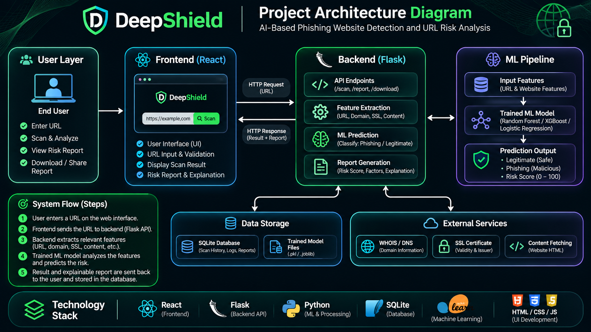

# DeepShield — Functional Accounts, Scan History and PDF Reports

## Features now wired to the Flask backend

- Optional account creation and login; URL scanning remains available to guests.
- Account data is stored in SQLite (`deepshield.db`).
- Passwords are stored as Werkzeug password hashes, never as plain text.
- Login state is held in a signed, HTTP-only Flask session cookie for up to 30 days.
- Scans are saved to the signed-in user's history and shown in the account panel and dashboard.
- PDF reports are generated by the backend using ReportLab.
- **Send report** emails the generated PDF as an attachment.
- **Download PDF** generates and downloads the report without requiring an email address or account.
- The email field is prefilled from the signed-in account, but can be changed.
- Guest scans are shown for the current page session only; they are not silently saved to an account.

## Project files

- `index.html` — dashboard and account/report UI.
- `style.css` — website styles.
- `script.js` — browser-side interactions and API calls.
- `app.py` — Flask API, SQLite accounts/history, PDF generation and SMTP email.
- `requirements.txt` — Python dependencies.
- `assets/deepshield-emblem.png` — the single shared DeepShield logo.

## Run locally on Windows

Open PowerShell in the DeepShield project folder.

### 1. Create and activate a virtual environment (recommended)

```powershell
py -m venv .venv
.\.venv\Scripts\Activate.ps1
```

If PowerShell blocks activation, use Command Prompt or run:

```powershell
.\.venv\Scripts\python.exe -m pip install -r requirements.txt
```

### 2. Install dependencies

```powershell
python -m pip install --upgrade pip
python -m pip install -r requirements.txt
```

### 3. Configure a strong local session secret

```powershell
$env:DEEPSHIELD_SECRET_KEY = "replace-with-a-long-random-secret"
```

Generate a random value with:

```powershell
python -c "import secrets; print(secrets.token_urlsafe(48))"
```

Copy the generated value into `DEEPSHIELD_SECRET_KEY`.

### 4. Configure email sending (Gmail example)

For Gmail, enable 2-Step Verification and create a Google **App Password**. Do not use your normal Gmail password.

```powershell
$env:SMTP_USER = "your-sender@gmail.com"
$env:SMTP_APP_PASSWORD = "your-16-character-google-app-password"
$env:SMTP_HOST = "smtp.gmail.com"
$env:SMTP_PORT = "465"
$env:SMTP_SECURITY = "ssl"
```

The email report feature will show a clear error until SMTP is configured. Direct PDF download does not need SMTP.

For other mail providers, set their SMTP host, port and security mode (`ssl`, `starttls`, or `none`) using the same environment variables.

### 5. Start the backend and leave the terminal open

```powershell
python app.py
```

The API runs at `http://127.0.0.1:5000`.

Check it in a browser:

`http://127.0.0.1:5000/api/health`

It should return a JSON status response.

### 6. Start the frontend

Open the folder in VS Code and use Live Server on:

`http://127.0.0.1:5500`

Use `127.0.0.1` consistently for both frontend and backend (not `localhost` for one and `127.0.0.1` for the other), or use `localhost` consistently. The frontend selects the backend hostname to match the page hostname.

Do not open the HTML using `file://`.

## Test the complete workflow

1. Visit the site. You should be able to scan as a guest without an account.
2. Click **Login** → **Create account**.
3. Enter full name, country, email and a password of at least 8 characters.
4. Submit. The account is stored in SQLite and the user is signed in.
5. Refresh the page. The signed session should remain active.
6. Scan a URL. If signed in, the scan is saved to that account's history.
7. Log out, then log in with the same email and password. Your account and history should still be there.
8. Scan another URL. Enter a recipient email and click **Send report**. The recipient should receive a branded PDF attachment.
9. Click **Download PDF**. A PDF should download directly without sending an email.

## Where data is stored

- `deepshield.db` — account records and saved scan history.
- Passwords are one-way hashed. The original password is not stored.
- Do not delete `deepshield.db` if you want to preserve accounts and scan history.
- Do not share the database file publicly.

## Important security and project limitations

- This is a local academic-project prototype. Before public deployment, use HTTPS, set `DEEPSHIELD_HTTPS=1`, use a strong secret stored outside source control, add CSRF protection, rate limiting, email verification, password reset, account deletion, database backups and production-grade monitoring.
- Never commit SMTP credentials, app passwords, secret keys or the SQLite database to GitHub.
- The current URL detection logic in `script.js` is still a **demo heuristic**, not a trained ML model. It does not truly inspect SSL certificates, DNS, WHOIS/domain age, page content or browser behavior. Connect the trained model to a backend inference endpoint before describing scan results as real ML predictions.
- The scanner's frontend result is submitted to the backend for report generation and history. For production, the backend must perform the scan itself and calculate the score rather than trusting a browser-supplied score.
## Project Architecture

